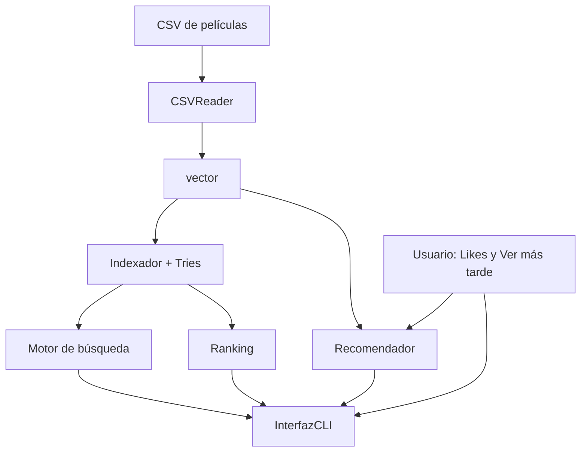

# CineSearch — Plataforma de streaming en C++

CineSearch permite buscar películas por palabras, frases o subcadenas en el título y la sinopsis. También ofrece filtros por director, género y reparto, resultados ordenados por relevancia, recomendaciones, `Like` y una lista persistente de `Ver más tarde`.

## Funcionalidades del avance

- Lectura robusta del dataset CSV, incluidos campos entre comillas y sinopsis multilínea.
- Normalización de texto e indexación en árboles Trie.
- Búsqueda parcial en títulos y sinopsis: `bar` también encuentra palabras que contienen esa secuencia.
- Consultas de varias palabras con unión de coincidencias y bonificación para la frase completa.
- Búsqueda independiente por director, género y actor/actriz.
- Ranking de relevancia y paginación de cinco resultados.
- Vista de detalle con sinopsis, `Like` y `Ver más tarde`.
- Pantalla inicial con la lista `Ver más tarde` y recomendaciones según los Likes.
- Persistencia local de las interacciones en `estado_usuario.txt`.

## Arquitectura



La interfaz recibe referencias constantes a los módulos del sistema. Así evita copiar el catálogo y mantiene separadas la presentación, la lógica de búsqueda y los datos.

## Estructura principal

| Archivo | Responsabilidad |
|---|---|
| `main.cpp` | Carga los datos, crea los módulos e inicia la interfaz. |
| `InterfazCLI.*` | Flujo interactivo, paginación, selección y mensajes. |
| `CSVReader.*` | Lectura, limpieza y normalización del CSV. |
| `Trie.*`, `Indexador.*` | Árbol de caracteres e índices por contenido y tag. |
| `Motor_de_busqueda.*` | API de búsquedas por contenido y tags. |
| `Relevancia.*` | Puntaje y orden de resultados. |
| `Recomendador.*` | Recomendaciones según películas con Like. |
| `Pelicula.*`, `Tag.*`, `Usuario.*` | Modelos y estado del usuario. |

## Decisiones técnicas

### Árbol elegido

Se usa un Trie porque cada nodo almacena un carácter y los prefijos comunes se comparten. El índice de contenido admite subcadenas recorriendo posibles puntos de inicio del árbol. Además, se mantienen Tries separados para director, reparto, género y origen; esto evita que una coincidencia de un director se devuelva erróneamente como actor.

### Relevancia

- Palabra encontrada en el título: **+10 puntos**.
- Palabra encontrada en la sinopsis: **+1 punto**.
- Frase completa encontrada en el título: **+50 puntos**.
- Frase completa encontrada en la sinopsis: **+10 puntos**.
- En empate se usa el identificador interno para obtener un orden determinista.

### Recomendaciones

Por cada película con Like se buscan títulos con director, reparto, género u origen en común. Cada coincidencia suma un punto. Se excluyen las películas que ya tienen Like y se devuelven las de mayor puntaje.

## Cómo ejecutar

1. Descarga `wiki_movie_plots_deduped.csv` desde el enlace indicado por el profesor y colócalo en la raíz del proyecto.
2. En CLion, abre esta carpeta, espera la carga de CMake y ejecuta `plataforma_streaming`.

Por terminal con CMake:

```bash
cmake -S . -B build
cmake --build build
./build/plataforma_streaming
```

También se puede proporcionar la ruta del dataset:

```bash
./build/plataforma_streaming /ruta/wiki_movie_plots_deduped.csv
```

## Pruebas

```bash
ctest --test-dir build --output-on-failure
```

Las pruebas cubren búsquedas simples y por frase, orden de relevancia, paginación, recomendaciones, duplicados de Likes y separación correcta de los campos de tags.

## Distribución del equipo

1. ETL y preprocesamiento.
2. Trie e indexación.
3. Motor de búsqueda y coincidencias.
4. Relevancia, recomendación e interacciones.
5. Interfaz, integración, documentación y entregables.

La documentación del avance y el guion sugerido para la exposición están en [`docs/AVANCE_SEMANA_8.md`](docs/AVANCE_SEMANA_8.md).

## Parte 2 – Interfaz + integración (integrante 5)

El menú de la terminal (`InterfazCLI`) es el mismo de la parte 1, mejorado. Une los módulos de todo el equipo:

| Opción | Qué hace | Módulo que usa |
|---|---|---|
| 1 | Busca por título o sinopsis. **Nuevo:** si la última palabra está incompleta, el árbol sugiere cómo terminarla (autocompletado) | Árbol (`Indexador::autocompletar`) + `Relevancia` |
| 2, 3, 4 | Busca por director, género y actor (ahora con un árbol por tipo de tag) | `MotorDeBusqueda` |
| 5 | Recomendaciones según tus Likes | `Recomendador` |
| 6 | Lista Ver más tarde | `Usuario` |
| 7 | **Nuevo:** lista de tus Likes | `Usuario` |
| 8 | **Nuevo:** tiempos medidos: carga del CSV, índice y cada búsqueda | – |
| 9 | **Nuevo:** cambiar el modo de búsqueda: Árbol, Secuencial o Paralela | `EstrategiaBusqueda` (Strategy, integrante 4) |

Like y Ver más tarde usan el patrón **Observer**: el `Usuario` avisa a la interfaz (`UsuarioObserver::actualizar`), y la interfaz muestra el cambio y guarda `estado_usuario.txt`.
La comparación archivo por archivo con el GitHub del grupo está en [`docs/VERIFICACION_GITHUB.md`](docs/VERIFICACION_GITHUB.md).

Igual que en la parte 1, al elegir una película se ven sus datos y la **sinopsis**, con estas opciones:
- **1. Dar Like / Quitar Like**
- **2. Agregar a Ver más tarde / Quitar**

Los cambios se guardan en `estado_usuario.txt`.
Los resultados salen de 5 en 5. `N` muestra la página siguiente y `P` la anterior. Ahora cada resultado muestra su relevancia y cuánto tardó la búsqueda. Las marcas `[L]` y `[V]` indican si la película tiene Like o está en Ver más tarde.

Los colores se ven en la consola de CLion. Para desactivarlos, define la variable de entorno `NO_COLOR`.

Otros ejecutables del proyecto: `tests_proyecto`, `tests_arbol` (pruebas del árbol) y `demo_arbol` (demo del integrante 1).
